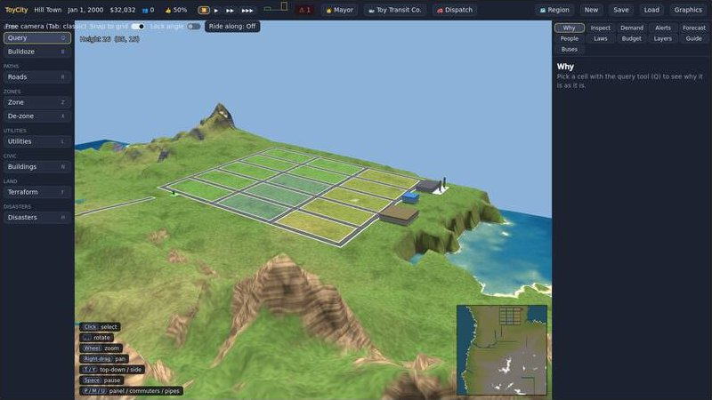
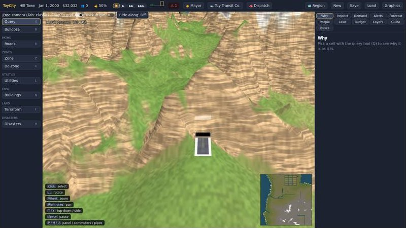
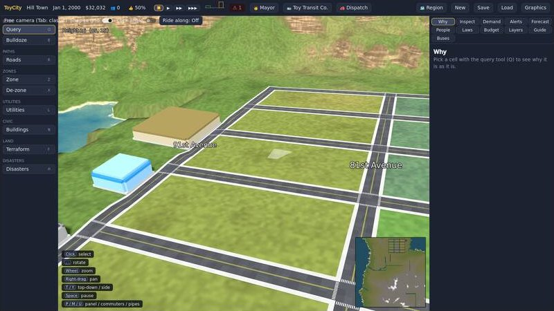
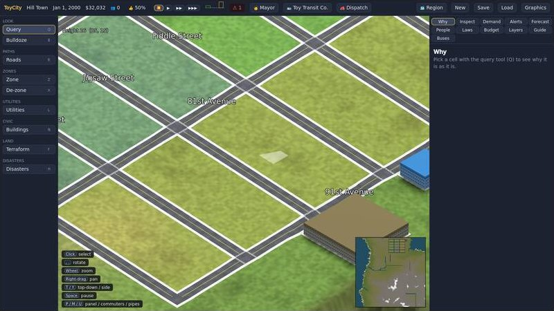
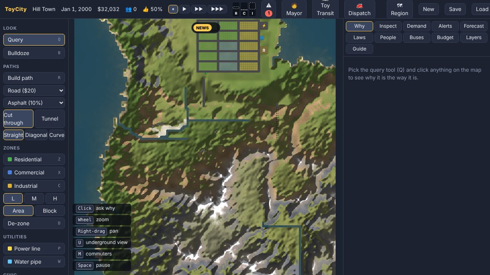
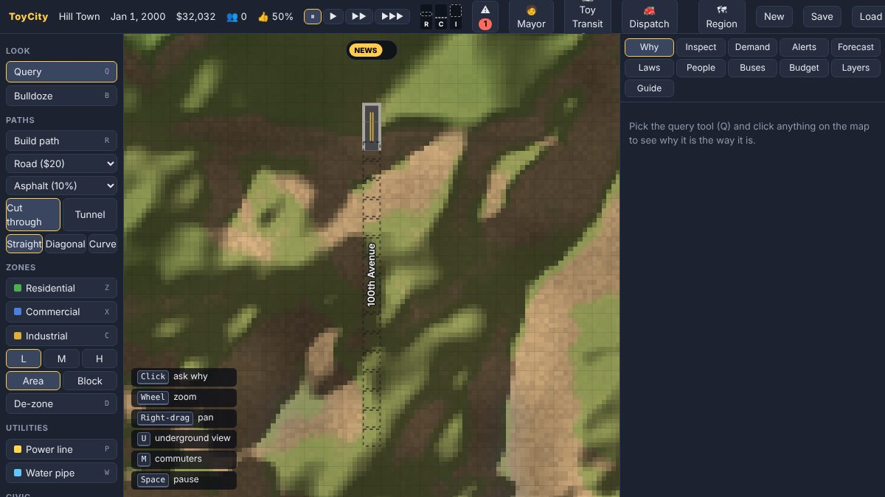

# ToyCity

An open-source city simulator in the spirit of SimCity 4: quirky, readable and moddable. The
simulation runs as a headless, authoritative server; front ends only draw it and send actions.
Later phases link side games (transport, emergency services, hospital, zoo, theme park, farm,
life sim) to lots in the city for live joined play.

This repository is at **Beta 3.2, part 1: hills.** Paths climb as steeply as their type and surface allow and the
ground is graded to fit them, with tunnels under hills and stairs on steep footpaths; the ground has soil over rock,
and the starter town sits on a hillside. Before that, **Beta 3.1: realistic terrain.** A city grows from paths, zones and services, every lot can
tell you why it is the way it is, cities sit side by side in regions with traffic, trade and deals across their
borders, and a bus company and the emergency services run as side games with their own screens. The ground is an
SC4-style heightfield of corners with mountains, rivers and floods. The Godot client in `clients/godot` is the way
to play; the web client stays as the debug and admin client.

## Screenshots

From the Beta 3.2 hill gate run (Godot, CI runner with software rendering) and the web client. Each release adds a
new set under [`docs/screenshots`](docs/screenshots); the Beta 3.1 set is in
[`docs/screenshots/beta3-1`](docs/screenshots/beta3-1).

| | |
| --- | --- |
|  |  |
| Godot, free camera: the starter town on its hillside | A road tunnelling under a hill, rock bands in the slopes |
|  |  |
| A street climbing the slope | Classic camera: the town's streets graded into the hill |
|  |  |
| Web client: soil, four rocks and snow, the same ground as Godot | Web client: the tunnel drawn dashed under the hill |

## Roadmap

Each phase ends with a gate the build must pass before the next begins.

| Phase | What it brings | State |
| --- | --- | --- |
| Pre-alpha | Deterministic sim core, protocol, saves, server, 2D web client | Done |
| Alpha 1–3 | A city that grows, talks back and links to side games; transport alpha | Done |
| Beta 1 | The Godot client, voxel buildings, graphics options | Done |
| Beta 2 | Multiplayer, consent, de-linking, emergency services alpha, transport beta | Done |
| Beta 3 | Regions, cross-border play, federated hosting, emergency services beta | Done |
| Beta 3.1 | SC4-style terrain, mountains, rivers and floods, realistic ground and roads | Done |
| Beta 3.2 | Hills: paths by type and surface, grading, tunnels, stairs, ground in layers (done); the clock, road weather, underground view, lighting, growing regions | In progress |
| Release candidate | Realistic assets on the realistic terrain; mod API, asset and lot editors, path designer; scenarios; onboarding; packaged builds; save promise | Next |
| 1.0 | City, transport, emergency services, multiplayer, regions and mods | |
| 1.1–1.4 | Venue core with the hospital, zoo and theme park; ordinance node editor; voice layer; scenario authoring | |
| 2.x | Farm, then life sim | |

## Releases

| Date | Release | Highlights |
| --- | --- | --- |
| 2026-11-01 | **Beta 3.2, part 1: hills** (PR #13) | Path grades by type and surface, every path graded into the ground, tunnels and stairs, made ground with retaining walls, soil over four kinds of rock with cuts that follow the material, a starter town on a hillside. [Gate](docs/GATE-BETA3-2.md) |
| 2026-10-31 | **Beta 3.1** (PR #12) | Corner heightfield, mountain generator, Godot terrain shader, realistic roads, rivers, bridges and floods, computer mayors build to their neighbours, bus lines across borders, web dispatch screen. [Gate](docs/GATE-BETA3-1.md) |
| 2026-10-31 | **Beta 3: Regions** (PR #11) | Regions on one clock, border connections, commuters and freight across borders, neighbour deals, computer mayors, federated hosting, emergency services beta. [Gate](docs/GATE-BETA3.md) |
| 2026-10-30 | **Beta 2: Together** (PR #7, #8) | Accounts and dedicated servers, seats, consent, council, dispute ladder, de-linking, emergency services alpha, trams, trains, freight, smooth shapes. [Gate](docs/GATE-BETA2.md) |
| 2026-10-29 | Graphics options (PR #6) | Low to Ultra presets and each setting on its own |
| 2026-10-28 | **Beta 1: The real client** (PR #5) | Godot client, classic and free cameras, voxel pipeline, company mode. [Gate](docs/GATE-BETA1.md) |
| 2026-10-28 | **Alpha 3: First link** | Side-game contract, seats and automation, the bus company |
| 2026-10-28 | Roadside stops, street names, service gauges | |
| 2026-10-28 | **Alpha 2: A city that talks back** | Demand by source, transit, curved roads, ordinances, events, advisors, disasters, agent tiers |
| 2026-10-27 | **Alpha 1: A city that grows** | Zoning, networks, budget, services, land value, commutes, the "why" query |
| 2026-10-27 | Pre-alpha | Sim core, protocol, server skeleton |

## Quick start

You need the .NET 10 SDK and Node 20 or newer.

```sh
# 1. Build the web client once
cd clients/web && npm install && npm run build && cd ../..

# 2. Run the server (it also serves the client)
dotnet run --project src/ToyCity.Server

# 3. Play: open clients/godot in Godot 4.7.2 .NET and press F5
#    (or open http://localhost:5180 for the web debug and admin client)
```

See [docs/BETA1.md](docs/BETA1.md) for the Godot client's controls, command-line options and frame budget.

To host a city for several players, run `dotnet run --project src/ToyCity.Server -c Release -- --dedicated`; players sign in and `host.json` beside the saves sets who may join. A side game can run in its own process or on another machine with `dotnet run --project src/ToyCity.SideGameHost -c Release -- --port 5190`, listed under `sideGames` in `host.json`. See [docs/BETA2.md](docs/BETA2.md).

The server starts a 128 × 128 map called Toyville with a small working town so there is
something to look at. Use **New city** for a blank map.

For client development, run the server as above and `npm run dev` in `clients/web`, then open
http://localhost:5173 (Vite proxies the WebSocket to port 5180). To point the client at another
server, add `?server=ws://host:port/ws` to the URL.

### Web client controls

| Key | Tool |
| --- | --- |
| Q | Query: click anything to see why it is the way it is |
| B | Bulldoze (in underground view it removes water pipes) |
| R | Build path (pick one of the 15 path types in the toolbar) |
| Z / X / C | Zone residential / commercial / industrial; V cycles density |
| D | De-zone |
| P / W | Power line / water pipe |
| E | Place a civic building (pick it in the toolbar) |
| T | Terraform (raise, lower, level) |
| U | Underground view |
| Space, 1–3 | Pause, speeds |
| Shift while dragging | Draw the vertical leg first |
| Wheel, right-drag, arrows | Zoom and pan |

Hints for the current tool are always shown in the lower-left corner.

## Tests and tools

```sh
dotnet test                                                 # unit and gate tests
dotnet run --project tools/ToyCity.Bench -c Release -- 10   # headless 10-year run with yearly report
TOYCITY_BIG=1 dotnet run --project tools/ToyCity.Bench -c Release -- 5 256   # stress: many towns on a large map
TOYCITY_WHY=1 dotnet run --project tools/ToyCity.Bench -c Release -- 2       # print why-reports for stuck lots
```

## Layout

| Path | What it is |
| --- | --- |
| `protocol/toycity.proto` | Wire and save format, shared by every front end |
| `content/` | Path profiles and building types (data, not code) |
| `src/ToyCity.Sim` | Deterministic simulation core: no I/O, threads or clocks |
| `src/ToyCity.Protocol` | Generated protobuf types and sim ↔ wire mapping, saves |
| `src/ToyCity.Server` | Fixed-tick host, WebSocket endpoint, static hosting |
| `clients/godot` | The Godot 4.7.2 .NET client: the way to play |
| `src/ToyCity.ClientModel` | What a .NET client knows that isn't drawing: the city mirror, tools, panels, the gate run |
| `clients/web` | 2D web client (SimCity 1 style): the debug and admin client since Beta 1 |
| `tests/ToyCity.Sim.Tests` | Tests, including determinism, replay and save gates |
| `tools/ToyCity.Bench` | Headless benchmark and diagnostics |

See [docs/ARCHITECTURE.md](docs/ARCHITECTURE.md) for how the pieces fit and
[docs/ALPHA1.md](docs/ALPHA1.md) for the Alpha 1 rules, numbers and known limits.

## License

GNU General Public License v3.0. See [LICENSE](LICENSE).
