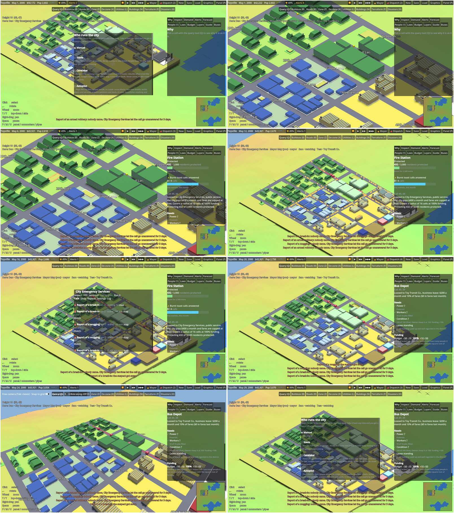

# Beta 2 gate run

The Beta 2 gate: four players on one dedicated server, playing a live session through the client model, with a
scripted de-link at the end.

## How it runs

`godot --path clients/godot -- --together together.json --server ws://HOST/ws --user "Mayor May" --password secret1
--new-account` (add `--shots DIR` for pictures) against a fresh dedicated server, whose first account becomes the
mayor. CI starts its own dedicated server and runs it after the Beta 1 gate.

The window is Mayor May. Tess, Dan and Sam are client models in the same process, each signed in over its own
connection and driven only through its own panels, as a player's clicks would drive them (`ClientModel/Gate/TogetherRun`):

1. **Everyone in.** May signs in first and is the mayor. The town runs while the other three make accounts and
   join, to day 120.
2. **Seats.** Tess claims the bus company and Dan the emergency services from the seat dialog. Sam claims nothing
   and shows as watching.
3. **Building.** May puts three bus stops along a street with the bus-stop tool, then a bus depot, a fire station
   and a police station off the east road, each where the planner first allows it.
4. **Stations leased.** From each station's panel May leases it to the emergency services on the standard
   public-service terms, and the stations come with their units.
5. **Dispatch.** Dan picks Scene command, turns on Pick responders and buys two more patrols. From then on his
   hands confirm the computer's picks for each call, and run each open scene in turn for 1.5 seconds before
   handing it to the crews.
6. **The company.** In her company view Tess leases the stops and the depot, draws a line through the stops and
   buys four buses.
7. **Live.** The city runs until Dan has sent units to a call, has run a scene through to its report card, and
   commuters ride Tess's line.
8. **Watching.** Sam sees the line on his map but not the company's books. When he tries to set a tax he is
   refused, and only he hears about it.
9. **Negotiating.** May offers Tess $100 off the depot's rent from the lease ladder, and Tess accepts.
10. **The same city.** With the clock stopped, all four clients agree on the day, funds, population and buildings.
11. **De-link.** Tess leaves with a copy from her seat dialog. Her copy arrives. In the shared city the company goes
    back to the computer on caretaker and its leases end, while Dan keeps his seat. Sam sees her go, and the
    mayor's seat dialog lists it. When Tess tries to take the company back, she is refused for the cooldown. All
    four still see the same city.

Any check that fails, or any step that times out, fails the run (exit code 1). `TogetherRunTests` plays the same
session against a dedicated server with the planner standing in for the mayor's Godot tools, then loads Tess's
copy: she is its mayor and runs its bus company there.

## Results (CI)

Every check passed on the CI runner (run 40968735803, Godot 4.7.2 in software OpenGL, the High preset), in 129
seconds of play:

| Check | Seen |
| --- | --- |
| The first account is the mayor | Mayor May |
| Four players on the server | Dan, Mayor May, Sam, Tess |
| Seats from the seat dialog | Tess runs Toy Transit Co., Dan runs City Emergency Services |
| Sam watches | spectator, no seats |
| Three bus stops, a depot and two stations, placed with the tools | stops at 21,39, 31,39, 41,39; depot 49,39; fire 49,42; police 49,49 |
| Stations leased as public services | the city pays $400 a month each |
| The stations come with units | 2 stations, 4 units |
| Dan buys two more patrols | 4 patrols, $9,560 left |
| Tess's line running | 4 buses every 8 min, a round trip of 34 min |
| Dan sends units to the city's calls | 5 calls |
| Dan runs scenes and gets report cards | 4 scenes; an armed robbery, 55 (arrest) |
| Commuters ride Tess's line | 72 riders a day, 6% of seats at the peak |
| Calls since Dan took them | 4 answered, 3 let go, 3 open |
| Sam sees the routes, not the books | 1 line, cash shown $0, no log |
| Sam can't set taxes, and only Sam hears so | "Only the mayor (Mayor May) or a deputy for the budget … can do that." |
| Tess accepts May's offer | depot rent $300 → $200 a month |
| All four see the same city | day 144: $43,921, 3,054 people, 120 buildings |
| Tess leaves with a copy | "Toyville Tess copy 144", 764 KB |
| The company goes back to the computer, its leases ended | 0 transport leases, the seat on caretaker |
| Dan keeps his seat; the mayor's seat dialog lists the de-link | yes; "Tess left" under past de-links |
| Tess can't take the company straight back | "Tess de-linked from Mayor May's city; they can share a city again in 85 days." |
| All four still see the same city | day 150: $43,921, 3,070 people, 123 buildings |

The mayor's window drew 967 frames, averaging 133 ms (p95 142 ms; the runner has no GPU), and the process
peaked at 671 MB with all four clients in it. `TogetherRunTests` passes the same session in about two minutes.

The moments from the mayor's screen, left to right and top to bottom: the seat dialog with all four players
present; the stops and stations; the fire station's panel, leased as a public service; Tess's line with the
routes shown; the dispatch board as the public sees it; the depot's lease after the new rent; the free camera; and
the seat dialog after Tess left.

## What the gate found

Fixed before it passed:

- **A company player couldn't lease a stop.** In a shared city, leasing was the mayor's alone, so Tess's Lease
  tool was refused, though the computer playing the same company has its requests granted. Now whoever runs a
  side game may lease free lots for it on the city's standard terms. Any other terms are still the city's to set.
- **Stations were offered as business leases.** The "Lease to…" dialog, in both clients, offered a fire station on
  the $40 business lease that a stop gets. It now offers a public service, as the sim's standard terms say.
- **The computer's picks went stale.** With Pick responders on, opening the board while a call waited left its
  picks empty. The computer's proposal then showed unticked, and Send did nothing.
- **The mayor's name.** The Godot run read the mayor's name from the connection after sign-in had replaced it with
  a token.

Left for the emergency beta:

- **Scene command at full speed outruns a player.** Every call Dan answers opens a scene that he runs in real time.
  At the fastest speed a day is 0.8 seconds, so a scene played for a few seconds holds its units for days. Calls
  that come in meanwhile wait and are let go after three. With two patrols, a town of 3,000 lost most of its crime
  calls. With four, and scenes handed over after 1.5 seconds, it lost 3 of 10. Options: slow the city while a
  scene is open, let the crews finish a scene left untouched for a few seconds rather than three days, or make
  Focus (only the scenes the player takes) the default when a player runs the service.
