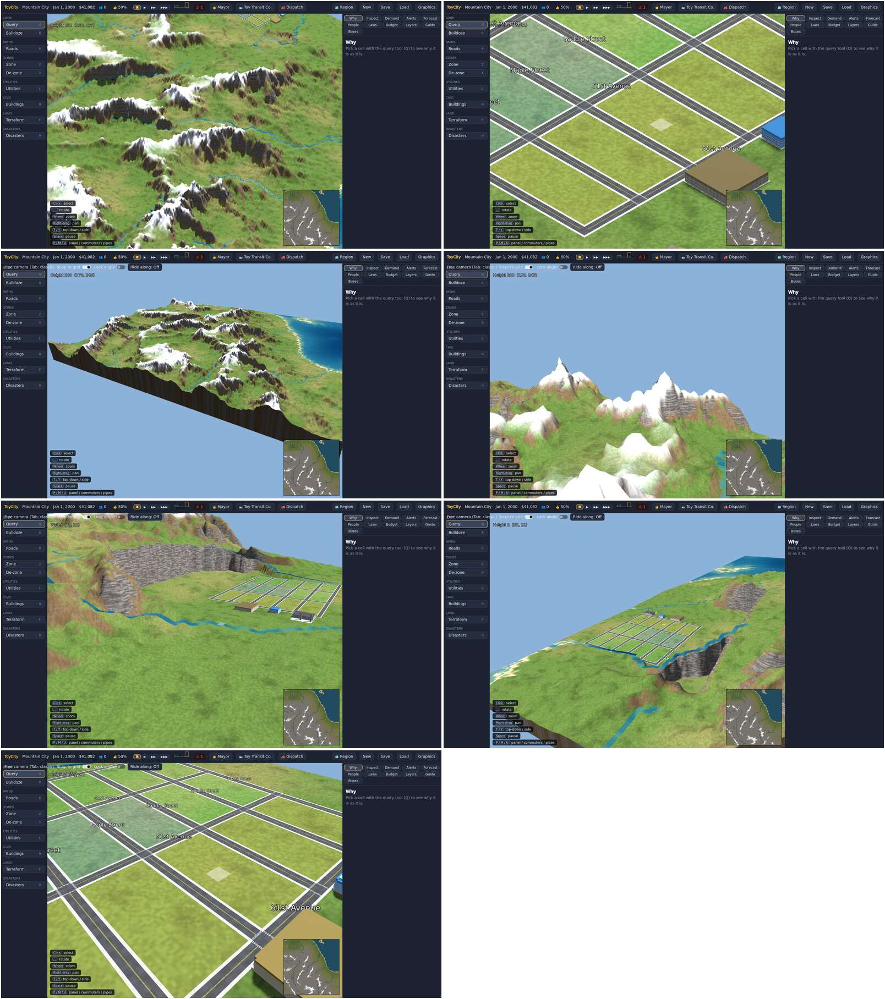
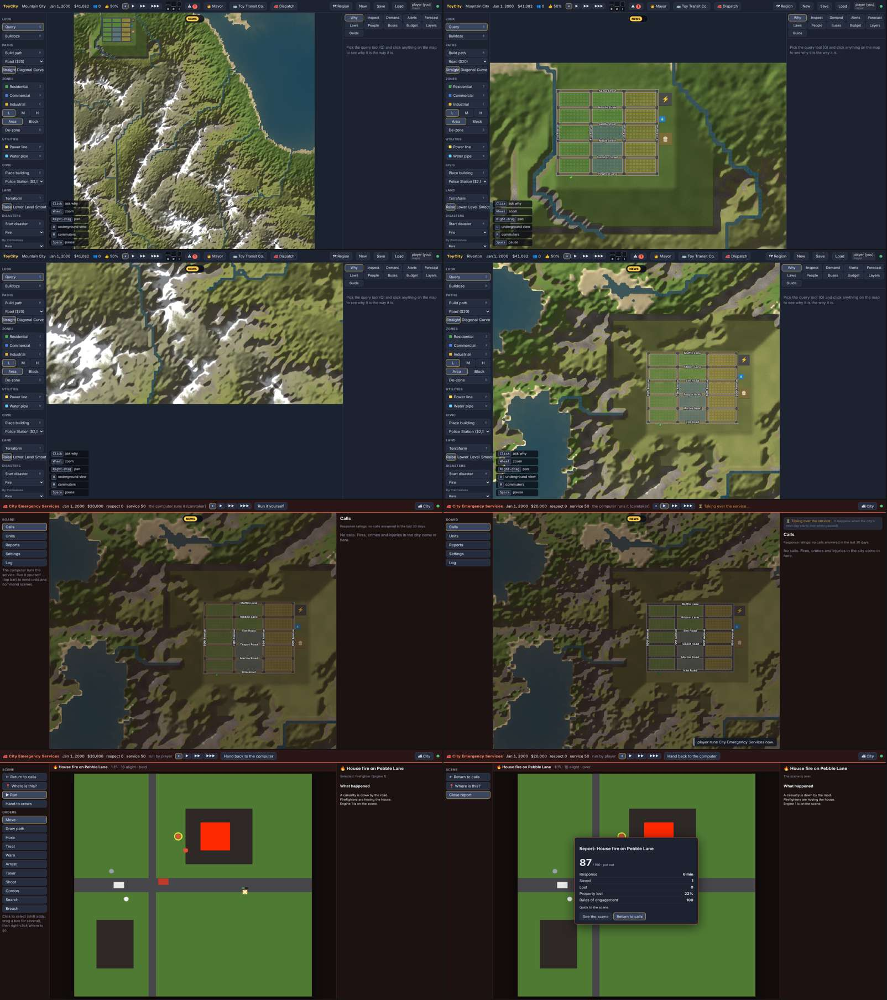

# Beta 3.1 gate run

The Beta 3.1 gate: a mountain city, the hardest ground the new terrain has to carry, looked at from every camera the
Godot client has, with frame times. The rest of Beta 3.1 (rivers, floods, border building, run-on bus lines) is
covered by the unit tests; the HTML client's half is checked by eye in the web sheet below.

## How it runs

`ToyCity.Godot --mountains mountains.json --graphics High --shots mountain-shots` (`Main.Mountains.cs`). CI runs it
as its own step after the Beta 2 gate run, copies its `MOUNTAIN` lines into the run summary, and prints a contact
sheet of its shots between `MOUNTAIN-SHEET-BEGIN` and `MOUNTAIN-SHEET-END`.

1. **Founding.** A new 256 × 256 city, "Mountain City", on seed 40 (the seed with the most high ground of those
   tried) with a starter town. The clock is held.
2. **Checks.**
   - Mountains: at least 300 m from the lowest dry ground to the peak.
   - Rivers: at least 200 river cells.
   - A starter town: at least 3 buildings and 100 road cells.
   - The ground is drawn from corners: (w + 1) × (h + 1) of them.
3. **Views.** Each is held for 5 s while frame times are measured, then shot:
   classic camera on the whole map and on the town; free camera on the peaks from afar, a mountainside low down,
   the river valley, the town from above the hills, and a street close up.

## Results (CI run 41241128689)

| Check | Result |
| --- | --- |
| Mountains | 400 m from the lowest dry ground to the peak at 178,245 |
| Rivers | 1,092 river cells; the nearest the town at 76,21 |
| Starter town | 4 buildings and 266 road cells around 56,21 |
| Ground from corners | 66,049 corners |

| View | Frames | Avg ms | p95 ms | Worst ms | fps | Triangles | Draw calls |
| --- | --- | --- | --- | --- | --- | --- | --- |
| classic, the whole map | 38 | 133.0 | 145.5 | 146.0 | 7.5 | 320,957 | 275 |
| classic, the town | 38 | 133.2 | 134.7 | 134.7 | 7.5 | 83,607 | 180 |
| free, the peaks from afar | 38 | 133.6 | 148.1 | 149.2 | 7.5 | 322,285 | 281 |
| free, a mountainside low down | 38 | 133.1 | 144.4 | 145.0 | 7.5 | 61,321 | 167 |
| free, the river valley | 38 | 133.4 | 147.0 | 147.0 | 7.5 | 150,693 | 207 |
| free, the town from above the hills | 38 | 133.4 | 140.5 | 140.5 | 7.5 | 182,957 | 221 |
| free, a street close up | 38 | 133.4 | 139.7 | 141.8 | 7.5 | 93,611 | 189 |

The CI runner has no GPU and renders with software OpenGL, so the frame times are the same in every view and say
nothing about a real card. What they do show: the whole 256-cell mountain map is about 320k triangles in under 300
draw calls, which is well inside what a desktop GPU draws at 60 fps.

What the shots show:

- Peaks get snow by height, steep faces turn to rock, lower slopes stay meadow; rivers run down the valleys to the sea.
- Roads follow the RoadLook rules: concrete with edge lines, centre lines on straight runs, crossings at junctions.
- The starter town sits on a levelled platform; where it is cut into a hillside the cut shows as a steep rock wall.
  That is the levelling working as designed, but it is the next thing to improve: the terraform smoothing tool and
  auto-grading when drawing roads (already on the list) should replace the wall with graded banks.

## The HTML client

Shot locally with Playwright against a Release server. The mountain map whole and at the town, a peak, Riverton
(rivers and a bridge), the dispatch board, the "Taking over…" wait, a scene, and a report card.

## A flake fixed on the way

The Beta 2 gate run builds its benchmark city on softened hills from a random seed. One CI run picked a depot block
rising more than a pad can level, and the depot was refused. `GateRun.FindSite` now only picks blocks whose heights
spread no more than a pad can take (`MaxPadRise`).
