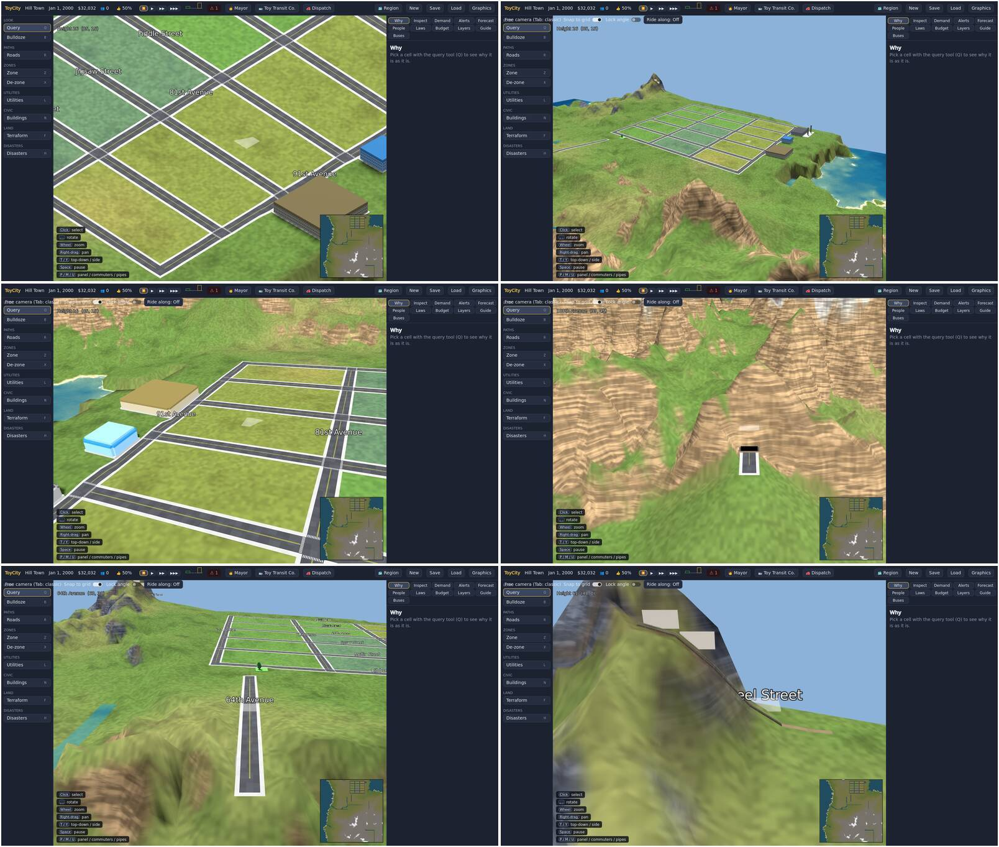

# Beta 3.2, part 1 gate run: hills

The gate for the first Beta 3.2 PR checks three things:

- a starter town on a real hillside
- ground in layers
- the three works that show what paths do on hills

These are looked at from the Godot client's cameras, with frame times. The rest is covered by unit tests:

- grades by type and surface
- grading costs, banks and cuts by material
- tunnels, saves and planner/server price parity

## How it runs

`ToyCity.Godot --hills hills.json --graphics High --shots hills-shots` (`Main.Hills.cs`, sharing the mountain run's
measuring). CI runs it as its own step after the mountain run, copies its `HILLS` lines into the run summary, and
prints a contact sheet between `HILLS-SHEET-BEGIN` and `HILLS-SHEET-END`.

1. **Founding.** A new 128 × 128 city, "Hill Town", on seed 5, with a starter town. The clock is held.
2. **Checks.**
   - The town's streets climb at least 6 m.
   - The ground has at least three kinds of rock and some bare rock.
3. **The hill works.** The client's own planner (`ClientModel/Gate/HillSpots.cs`, the server's grading) finds, near
   the town and on open ground, three works:
   - a road that tunnels under a hill (the most cells under it)
   - a road cut deep into the rock (short of a tunnel)
   - a footpath up ground steeper than a ramp holds, so it is drawn as stairs

   They are built as player actions, then checked: the tunnel has cells under the hill.
4. **Views.** Each is held for 5 s while frame times are measured, then shot:
   - classic camera on the town
   - free camera on the town from the hills, and on a street on the slope
   - free camera on each of the three works

`HillTests` runs the same search against the server in process. It checks that each work's planner price, rock
included, equals the server's, that the tunnel and stairs are there, and that the cut reached the rock.

## Results (CI run 41282667863)

| Check | Result |
| --- | --- |
| Town on a hillside | Streets from 57 m to 99 m, 42 m apart |
| Ground in layers | 4 kinds of rock; 7,016 corners of bare rock |
| Hill works found | A road tunnelling under a hill at 99,43 ($5,407); a road cut into the rock at 63,31 ($1,835); a footpath up the hill as stairs at 45,1 ($647) |
| Tunnel | 16 cells under the hill |

| View | Frames | Avg ms | p95 ms | Worst ms | fps | Triangles | Draw calls |
| --- | --- | --- | --- | --- | --- | --- | --- |
| classic, the town on its hillside | 39 | 130.0 | 133.3 | 133.3 | 7.7 | 71,593 | 174 |
| free, the town from the hills | 38 | 132.0 | 134.8 | 135.6 | 7.6 | 96,311 | 183 |
| free, a street on the slope | 38 | 133.6 | 146.7 | 147.3 | 7.5 | 131,155 | 199 |
| free, a road tunnelling under a hill | 38 | 133.6 | 145.5 | 145.5 | 7.5 | 64,327 | 172 |
| free, a road cut into the rock | 38 | 133.5 | 140.0 | 140.0 | 7.5 | 82,851 | 200 |
| free, a footpath up the hill as stairs | 73 | 69.4 | 70.4 | 76.0 | 14.4 | 23,603 | 152 |

As before, the CI runner renders with software OpenGL, so frame times say nothing about a real GPU.

What the shots show, honestly:

- **The town.** It sits on a 7% plane that falls 42 m across it, and its streets are graded into it. From the free
  camera it still reads as a tilted platform, not a town that follows the land. A town laid out along the contours
  is the next step for starter towns.
- **The tunnel.** It reads well: a portal in the hillside, with rock showing in bands on the steep slopes around it.
- **The rock cut.** It is built and priced correctly, but this camera angle, looking down the road, doesn't show its
  sheer sides. It needs a camera across the cut.
- **The stairs.** The planner found them on the map's top edge, where the camera can't get a good look. Restricting
  the search to cells away from the edge would fix that next time.

## The HTML client

Shot locally with Playwright against a Release server, on the same seed with the same works:

- the whole map, with its soil, rock and snow
- the town
- the tunnel, drawn dashed under the hill

The three shots are in `docs/screenshots/beta3-2/`.
