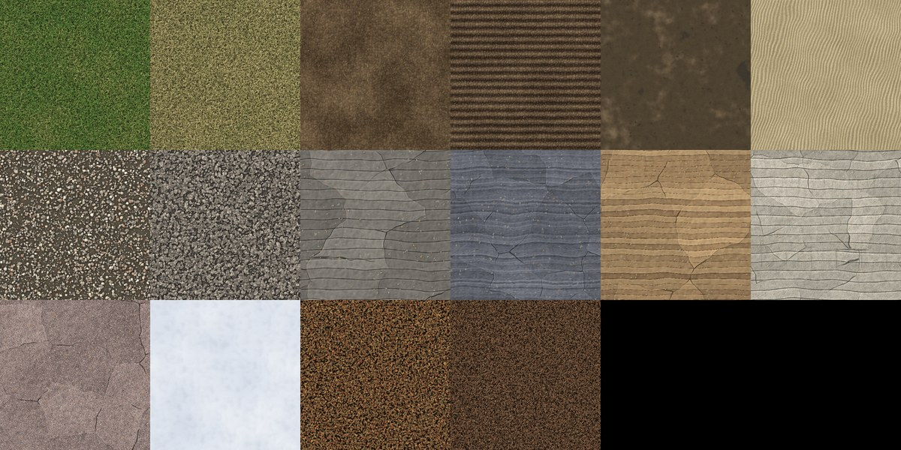

# Release candidate, part 6: terrain textures

The ground has real textures where the terrain shader used to paint flat colours. There are sixteen materials,
each made in code as a square that tiles, with its colour, its relief (a height, from which come its normals and the
shading of its hollows) and its roughness. The shader blends them by slope, height, soil, moisture, season, the rock
under the ground and the plant layer. It maps cliffs from the side and adds relief up close. The web map paints with
what each texture averages to, so the two clients show the same ground.

- **The materials:**
  - **Grass:** meadow in tussocks about 30 cm across, with 40,000 blades leaning out from them, last year's dead
    blades among them, clover in the lush parts and small daisies and yellow flowers. Dry grass is the same turf late
    in a dry summer: mostly straw, no clover.
  - **Soils:** bare earth in clods, with stones and dead stalks. Tilled soil is raked into furrows every 30 cm. Mud is
    puddled in its hollows, with a sheen and footprints. Sand has wind ripples with dark grains and shell bits.
  - **Stones:** river gravel is rounded pebbles of many rocks. Scree is larger, angular, one grey and lit on its facets.
  - **Rock:** bedrock, plus each of the sim's four kinds as it breaks:
    - Shale is blue-grey in thin flaking beds.
    - Sandstone is tan and rust in thick worn beds.
    - Limestone is pale, in jointed blocks that are pitted and rain-streaked.
    - Granite is pinkish, speckled with crystals.
    - All of them have thin joints that wander and die out, with lichen on top.
  - **Snow and woods:** snow lies in soft drifts. Leaf litter in browns and russets lies under broadleaves, and a mat
    of needles with cones lies under conifers, with twigs in both.
- **Made the same everywhere:** the recipes are written in metres, not pixels, so a texture is the same ground at 256,
  512 or 1024 px. Each texture is brought to average exactly its listed colour, which the web map and the plain
  look use. The textures are deterministic, so both clients and the checks agree on them.
- **Blending:**
  - **Moisture** is higher along river banks and near water.
  - **Dryness** rises in patches, on south-facing slopes and in late summer, and moves the ground from meadow to
    dry grass to earth.
  - **Rock and scree** take over as the ground steepens, in the kind of rock the region has, with weathered banding.
  - **Made ground:** banks cut or filled for roads and lots show earth.
  - **Plants:** woods lay their litter under their canopy.
  - **Farms:** fields show the tilled texture in their crop's colour, tracks are earth, and yards are gravel and grass.
  - **Snow** lies above the snow line and on gentle ground when it has snowed.
  - **Water:** shores are sand and the riverbed is mud and gravel.
  - **Blend edges:** materials meet by height, so the stones of the gravel stand out of the mud around them rather
    than fading into it.
- **Up close and far off:**
  - **Up close:**
    - Cliffs are mapped from the side, with the beds level.
    - Each layer's tiles are turned and shifted so their repeats don't line up.
    - Detail normals and ambient occlusion give the ground relief in the light.
  - **Far off:** the hollows of the land are shaded darker, from a sky-openness value baked into the terrain mesh.
    A second meadow sample at a seventh of the scale breaks up large fields.
- **Ground option:** a new graphics option sets how the ground is drawn:
  - Plain is the old flat colours.
  - Textured is 512 px textures without relief.
  - Relief (the default) adds the side mapping on cliffs and detail normals.
  - Fine is the same at 1024 px.
  - The Low and Medium presets use Textured, High uses Relief and Ultra uses Fine.

## What changed

- **The client model (`Graphics/Ground`):**
  - **`GroundNoise`:** tileable value and Perlin noise, fBm, ridged noise, Worley cells and a seeded scatter.
  - **`GroundCanvas`:** paints a tile with dabs, blades and lumps, and finishes it into an RGBA colour map (height
    in alpha) and an RGBA detail map (normal lean, roughness, occlusion).
  - **`GroundTextures`:** the material list (id, name, metres a tile, average colour), the recipes, and `MakeAll`,
    which makes them side by side on every core.
- **Graphics settings:** the `Ground` option, saved as `ground`.
- **The Godot client:**
  - **`GroundTextureSet`:** builds the two texture arrays with mipmaps. The first start makes the textures and keeps
    them in `user://ground/`, so later starts only read them. `GroundTextures.Version` makes them again when a recipe
    changes.
  - **`CityView`:** hands the shader the arrays and the plant layer as a texture, and bakes each corner's openness to
    the sky into the mesh.
  - **`terrain.gdshader`:** rewritten around a blend of material samples. Each material is sampled only where its
    weight counts.
  - **The hills run:** two new close-up views, of a meadow and of the map's steepest crag.
- **The web client:** `render.ts`'s ground colours are the textures' averages.
- **`tools/ToyCity.GroundPreview`:** writes each material as a sheet (tiled, its maps, and a close-up) with its
  timing and average, for tuning recipes.

## Checks

- **ClientModel tests:**
  - Every material makes at its size, and its average is within 3 of its listed colour.
  - Every material tiles without a seam.
  - The textures come out the same every time.
  - Bad sizes and names are refused.
  - The Ground option maps to the right look and pixel size, and presets climb from Low to Ultra.
  - All 208 tests pass.
- **Cost:**
  - Making all sixteen at 512 px took 2.6 s on a 4-core runner.
  - Reading them back from disk on later starts took 1.0 s.
  - Under software rendering (llvmpipe), each frame takes about twice as long to draw. The hills run's wall time went
    from about 17 minutes to over 25, so CI's gate, mountains and hills runs now have 40 minutes each, and the
    benches have 15. The frame times those runs report don't show the change, because they sit at the runner's frame
    pacing (133 ms).
  - Plain, in the Ground option, draws the old flat colours for machines that need the speed.
  - How much the textures cost on a real graphics card is for the GPU test (`--bench`) to measure on your own
    hardware.
- **Godot runs:** the gate and mountains runs pass with no shader errors. Locally, the hills run took all 19 of its
  ground and lighting views with no shader errors before the old 25-minute limit stopped it. CI runs it in full.

## Part 6.1: plants in their place

Zac's notes on the part 6 shots were that plants grew where they shouldn't: trees had no height limit, and bushes
grew over the roads.

- **Height bands (`Plants.cs`):**
  - Broadleaf woods give way to conifers at 200 m above the sea, or at 120 m on a north face.
  - Conifers stop at a treeline at 260 m.
  - Above that only scrub grows, up to 280 m, where the snow starts to lie.
  - Nothing grows higher than that, or on a face steeper than about 55°.
  - Each month, trees above the band their kind lives in, from an older save or a planting, lose a crown a third of
    the time, until they're gone.
  - The tree planter plants a conifer where a broadleaf wouldn't live, and won't plant above the treeline.
- **Off the roads:** a crown used to stand anywhere from 8% to 92% of the way across its cell. A bush or tree beside
  a road could hang up to 3 m over it. Now a cell's crowns keep off any side with a road or a building next to it, by
  as far as their crown reaches. This holds in the 3D view (`TreeLayout.Spots`, `TreesView`) and on the web map
  (`trees.ts`). A road or building that clears a cell lays out its neighbours' crowns again.
- **Cliffs:** the broad variation that breaks up large meadows was projected from above everywhere, so it smeared
  down cliff faces like hair. It now keeps to the grass. A material seen from the side is no longer turned, so rock
  beds lie level.

**Checks:**
- **New tests:**
  - Sim: on six maps, some of them mountainous, nothing grows above its kind's band.
  - ClientModel: crowns stay inside a cell whose four sides all keep them off.
- **Test suites:** ClientModel (209) and Sim (322) pass.
- **Godot runs:** the hills run and the mountains run pass.
