# River shorelines gate (Beta 4 follow-up)

Zac, 2026-11-03: "the rivers probably need another turn or two. we have made rivers in the prairie kiosk
project. attempt to excavate that concept and see what we can do to improve the shoreline."

## What came from the prairie kiosk

The Flint Hills creek there is drawn quite differently from a grid of cells:

- It follows a smoothed centre line with a half-width and a bed depth at each point.
- Its water is a ribbon that lies over the banks, so the shore is wherever the bank's slope meets the water.
- The ground beside it is coloured in bands: a wet band of mud and cobble at the waterline, then floodplain.

## What changed

- **Shaped channels (sim, `Rivers.Channels`).**
  - Each river follows a line smoothed over three cells up and three down its main stem.
  - Its half-width grows with the water feeding it, from ¾ of a cell up to 2 cells.
  - The channel is cut with a flat bed across the middle half, sides that rise to just under the water, and a short
    cut bank. The bank above then rises a step for every 1¼ cells, where it used to stand as a one-cell
    staircase.
  - The water surface runs smoothly along each stretch, including down rapids.
  - Ground the channel cuts under the river's water joins the river and flows into the nearest cell of the main
    stem downstream, so floods, water quality and growing-region exits follow it.
- **Old regions keep their rivers.** A region regenerates its ground from its seed, so `Region.Channels` is saved
  (RegionSave field 18). Regions saved before this change load with it off. A fixed region's ground with channels
  off hashes exactly as before.
- **Bridges** sit half a step over the water, where they used to sit a whole step over. This is done the same way
  in the sim's grading, the client planner, the web planner and border building. The lower deck still meets a
  road along the bank at an even grade.
- **Godot.**
  - The river sheet runs one cell past the river at the river's level, so the terrain clips it into a contour
    shoreline.
  - The terrain shader colours the banks from a new `river_banks` texture: wet mud and gravel at the waterline,
    silt and a riverbed under the water, and lusher floodplain grass up to about 7 m over the water.
- **Web.**
  - The river's level is blended between cell centres, and the shore is drawn where the ground meets it.
  - The banks get the same wet band and floodplain colours as in Godot.
  - River water is drawn at least a step deep, so it reads as water, not mud.

## Checks

- **Sim tests: 284 pass.** They include the new `RiverChannelTests`:
  - Channels make rivers wider than the old cut on every seed tried, with no steeper banks for each cell of river.
  - No river climbs.
  - A region saves and loads its channel flag, and an older region keeps its old rivers.
- **Client model tests: 116 pass.** The road preview's price matches the server's again with the lower bridge
  deck.
- **CI is green on cc6a0cc.** The run caught two earlier test races that had nothing to do with rivers, and both are
  fixed:
  - The merge test now builds its roads on dry land.
  - The franchise test now waits for the mayor's client.
- **Shots:**
  - Web: Playwright against a local server, seed 42.
  - Godot: the CI mountain gate's contact sheet (software OpenGL).

## Trade-offs to watch

- Rivers are wider, 2 to 4 cells on the plains, so they take more of a city's land.
- Wide rivers on flat floodplains can spread into broad, lake-like reaches.

# Round 2: meanders, rain-fed rivers, the river brush and dams

Zac, 2026-11-03: separate the water from the grid, vary its level, let rivers be painted on at a depth, run them
from high water to a lake, pond or sea, let the rain of the past month set the level, and draw dams as in Cities:
Skylines. He picked the order on the decision card: meanders, then hydrology, then the brush and dams. There's no
full fluid sim; the water's level is worked out from the rain and the ground, so every client draws the same water
as the sim damages buildings with.

## What changed

- **Meanders (channels version 2).**
  - The channel's line wanders to either side of its drainage cells by slow noise in the region's own cells, so it
    runs on across tiles, and each bank's width wobbles.
  - The old grid-aligned trench is no longer cut under the channel.
  - `Region.Channels` is now a version (RegionSave field 18 is a uint32, and a saved `true` reads as 1), so a region
    keeps the rivers it was made with.
- **Ponds and lakes (channels version 3).**
  - Basins the flood-fill finds hold water where the rain on their catchment keeps up with them: a basin fills up to
    the level where it has one water cell for every 30 cells draining into it.
  - A basin is left dry if it would hold fewer than 6 cells, or average under 1½ steps deep.
  - A pond's water stands at one level, and the channels run into and out of it.
- **Rivers carry the month's rain.**
  - Each day the region works out each tile's flow from the rain over the river upstream as its water arrives: half
    from the last month (this week counting most), half from the last three, against a usual month.
  - Flow runs from a third of usual after a dry season to six times it under weeks of storms. On seed 7 the median
    is 78%, the river floods on 4% of days, and it runs low on 37%.
  - Each river cell's water stands at its usual level plus a rise that goes as the flow to the 0.6, times its usual
    depth: a metre for a stream, up to three for a wide river. Floods spread from that water by the decimetre.
  - The flood stage follows the flow, and low water and its return make the news. Save format 17 keeps the flow.
  - The shared sums are in `RiverFlow.cs`, used by the sim and the client model and ported to the web client.
- **The river brush.**
  - It digs a channel along a straight stroke, 1 to 5 cells wide and 1 to 4 steps deep.
  - Its water starts at the river it's dug from, or the ground at the start, and only ever falls along the stroke.
  - It costs $60 a cell for each step it goes down. It won't cut through buildings, roads or dams.
  - A long stroke is sent as several digs end to end.
- **Dams.**
  - A dam is drawn across a river, bank to bank, at most 40 cells long. It holds the water 1 to 8 steps over the
    river there.
  - The reservoir fills at once over the ground under that level, behind the wall. Where the river stands level
    either side, it fills on whichever side holds it.
  - A dam isn't built if its water would:
    - run round its end into the river below or the sea;
    - spill over the city's edge (except up the river it comes in on);
    - drown buildings or roads;
    - spread past 4,000 cells.
  - A reservoir holds its level whatever the rain. The river below a dam runs between 60% and 150% of its usual flow,
    so it neither floods nor runs dry (`RiverFlow.Held`).
  - Bulldozing any cell of a dam takes it all down, and the water goes back to the level it was.
  - Save format 18 keeps the dams and the rivers' levels from before them. Cell updates now carry the river and dam
    layers, so clients see dug rivers and reservoirs as they're made.
- **Hydro plant.** A new 2×2 power building, $28,000, which has to stand within three cells of a dam. Its output,
  up to 9 MW, goes with the fall from the reservoir to the river at the dam's foot (full at 14 m). It also goes with
  the flow through it, which the reservoir evens out between 40% and 120%.
- **Both clients.** River and Dam are under Land, then Water:
  - The brush has width and depth options; the dam has its rise.
  - Each shows a preview with a cost.
  - Dams are drawn as concrete.
  - Each client draws the water at its own level: a reservoir at its spillway, the river below at its evened flow.
- **Straight water strips fixed.** On the mountain map (seed 40), water stood in long straight lines, up to 28 m
  over dry ground. There were two causes:
  - A big hollow was split along the lines its water drains by. Each strip was filled as a lake on its own.
    - Now a hollow is one basin, filled from its lowest cell up.
    - Its water never stands over lower ground at its edge.
    - A hollow too big for the rain to fill stays dry.
  - On steep runs, the channel cut for the next cell down left this cell's water standing as a block over its bed.
    - Now a river is at most a step deep over the ground it ends up on.
    - It still never climbs downstream.

## Checks

- **Sim tests: 291 pass.** They include the new `DamTests` and `RiverFlowTests`:
  - The brush's water only falls along its stroke, and its bed is the depth asked under it.
  - A dam fills its reservoir at its spillway level, the river below it is held, and a city saves and loads its
    dams.
  - Bulldozing a dam brings every river cell back to what it was.
  - A hydro plant beside a dam makes power, and one placed away from a dam is refused.
  - A dam that stops short of the bank is refused.
  - The rivers rise and fall with the month's rain, flooding now and then and running low after dry months.
- **Client model tests: 116 pass.** They include the new `DamClientTests`:
  - The dam tool's drag sends what the server builds, and the client sees the same dams, rivers and held water as
    the server.
  - A reservoir is drawn at its spillway level.
  - A long brush stroke is sent as digs the server takes, end to end.
- **Web client.** Playwright against a local server: a region on seed 11 for the dam and seed 7 for the brush, using
  the real tools from the build menu.
- **Godot.** The mountain gate now builds a dam and digs a river, then looks at both. Its contact sheet comes from
  CI.

## Shots

| | |
| --- | --- |
| 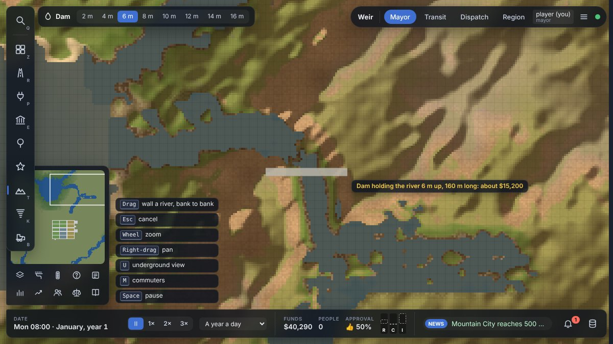 | 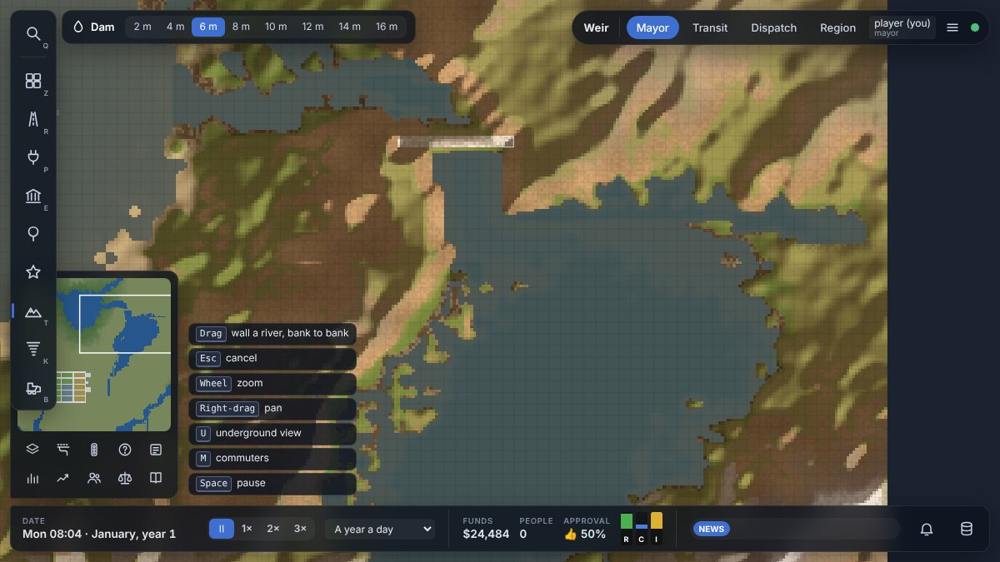 |
| 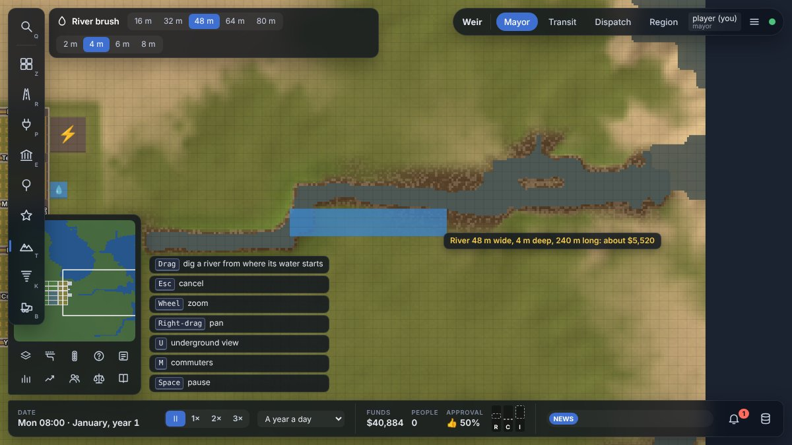 | 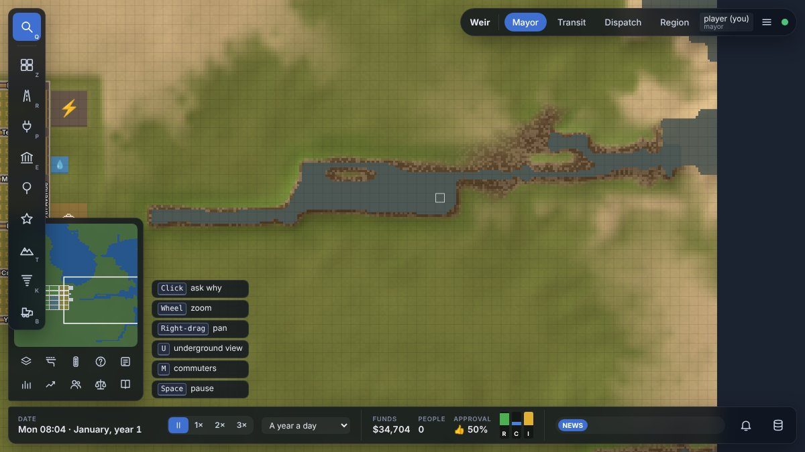 |
| 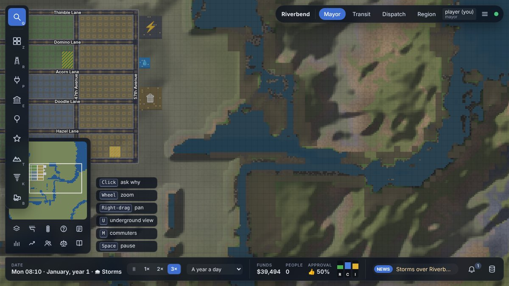 | 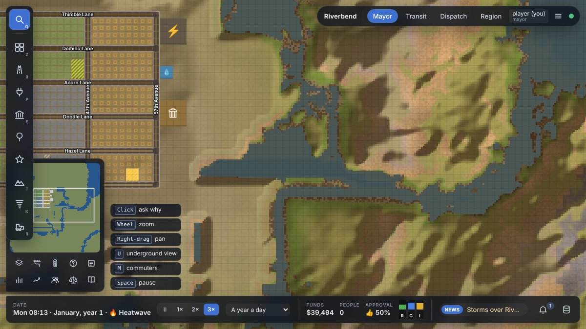 |
| 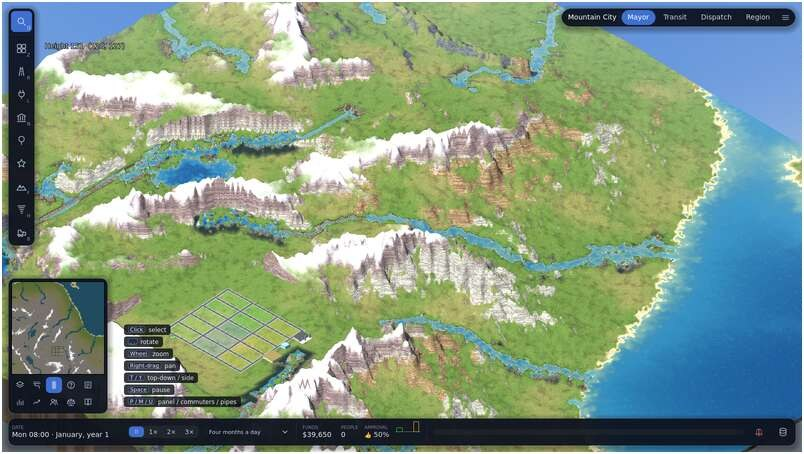 | 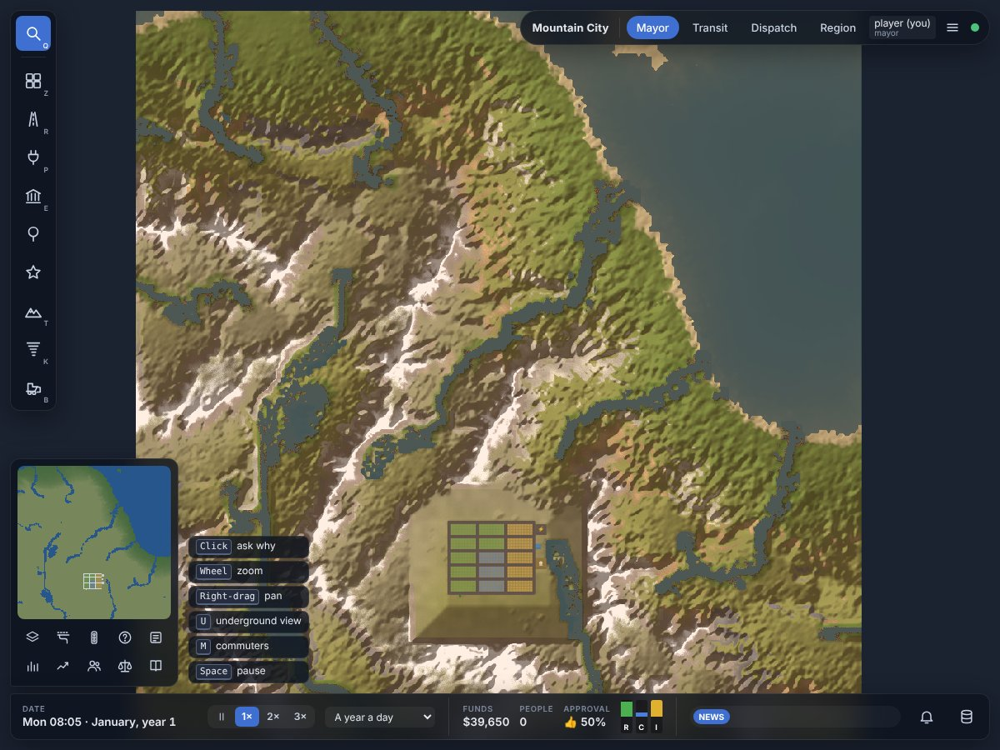 |
| 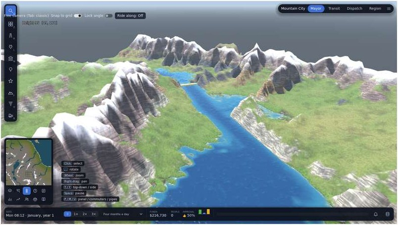 | 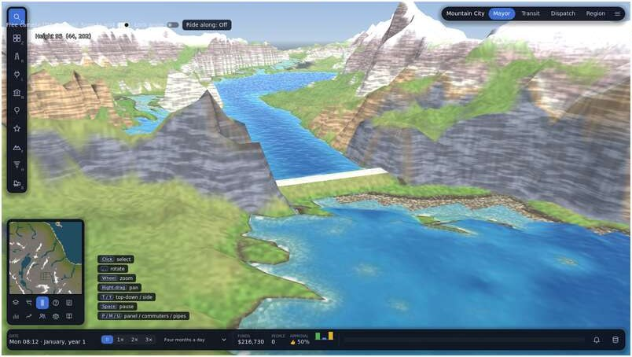 |
| 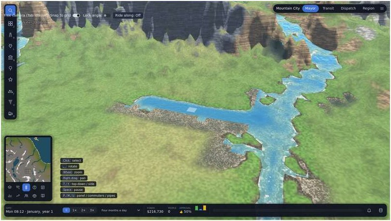 | |

## Trade-offs to watch

- The reservoir fills at once. A filling time would need the water's level to be kept as state, and it isn't yet.
- Dams and the brush draw straight lines. A curved dam or a winding dug river is drawn as several strokes.
- A dug river's banks are as straight as the stroke. Its own wobble could come later, like the generated
  rivers'.
- The flow is the same for the whole city, from the region. Only dams change it locally.
- The rivers start a new region low, in January after a dry run-in. That's right by the rule, but the first news
  can read oddly.
